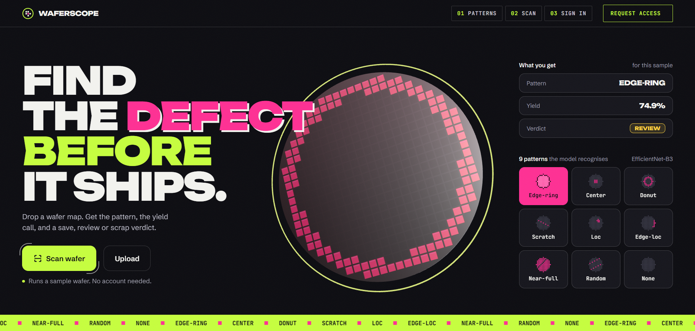
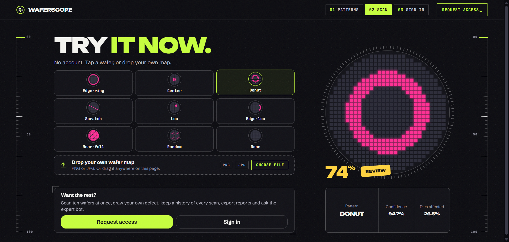
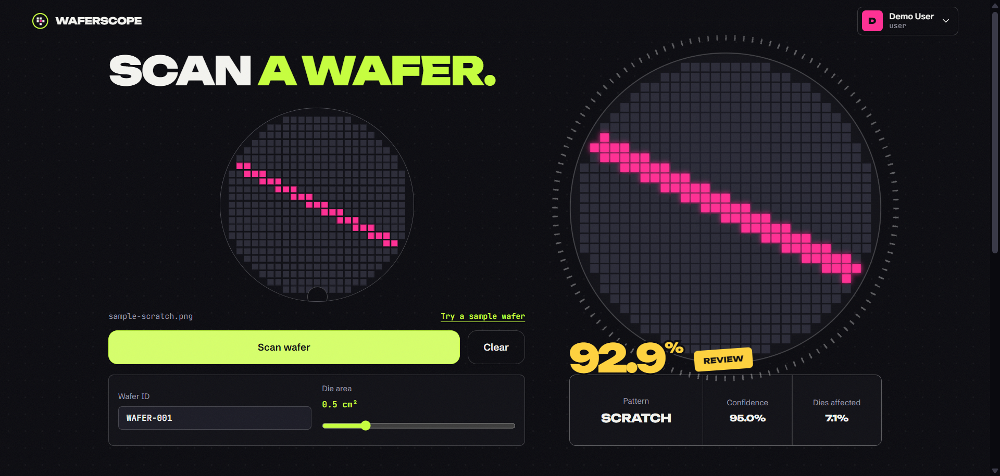
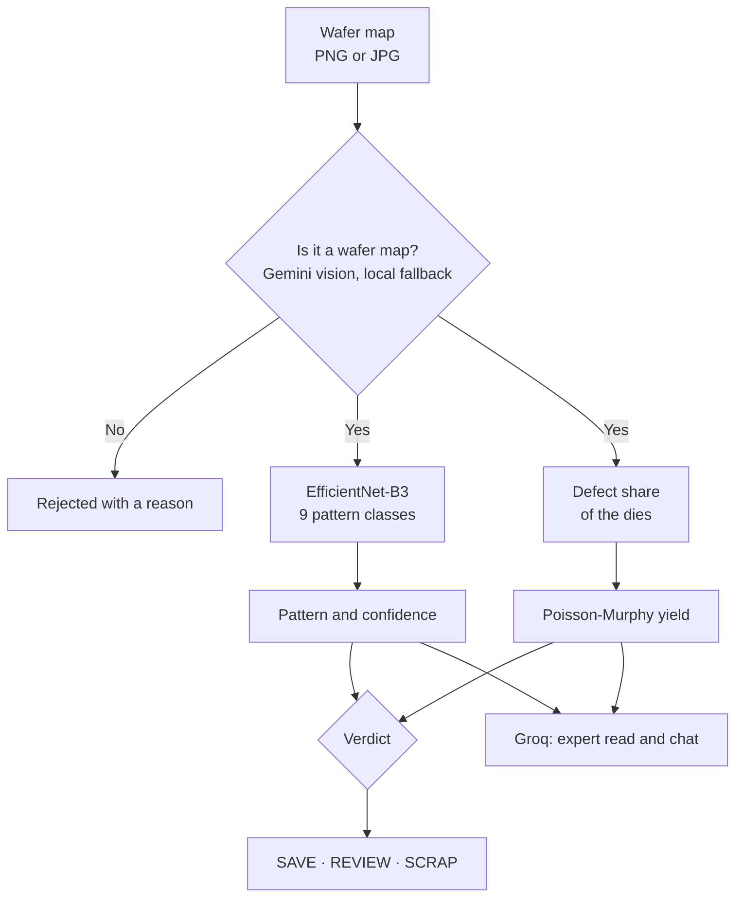
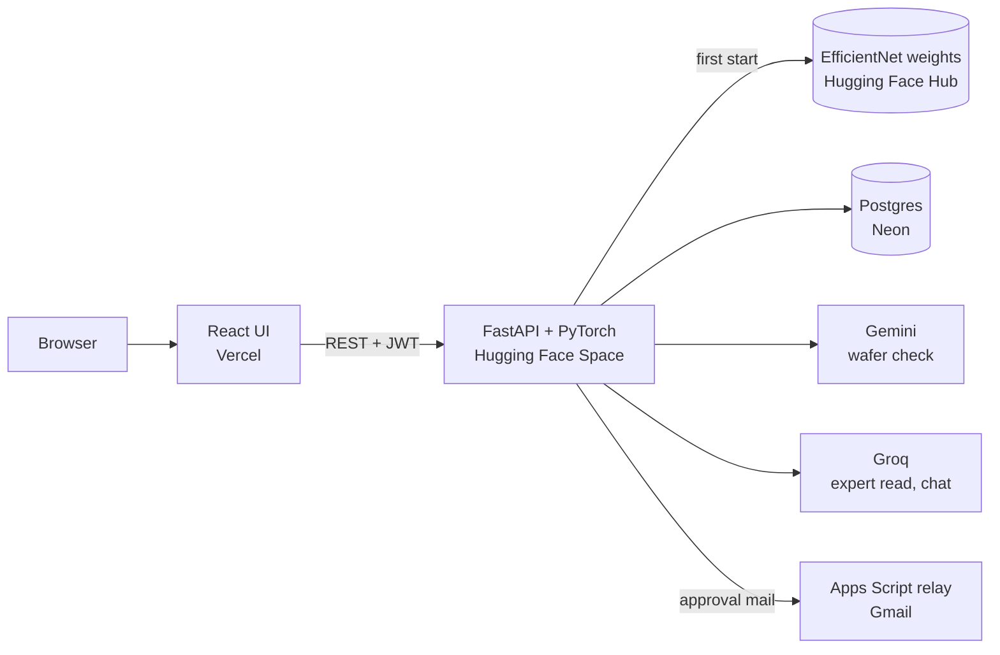
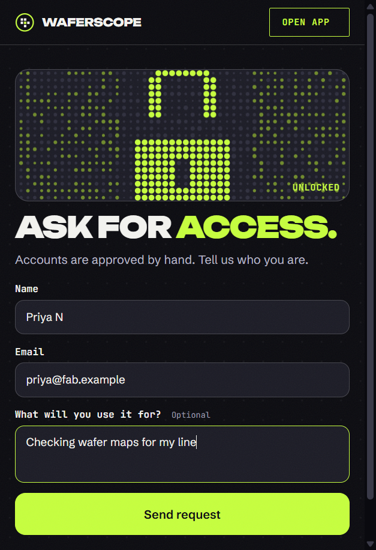

<p align="center">
  <a href="https://waferscope-two.vercel.app">
    
  </a>
</p>

<p align="center">
  <a href="https://waferscope-two.vercel.app"><b>Live demo</b></a>
  &nbsp;·&nbsp;
  <a href="#how-it-works">How it works</a>
  &nbsp;·&nbsp;
  <a href="#run-it-yourself">Run it yourself</a>
</p>

<p align="center">
  
  
  
  
  
</p>

Waferscope reads a semiconductor wafer map and tells you three things: **which of nine defect patterns it shows, what yield to expect, and whether to save, review or scrap the wafer.** It adds an expert read of the result in plain language and a chat that knows the scan.

Anyone can try it without an account: tap a sample wafer on the [scan page](https://waferscope-two.vercel.app/scan), or drop your own map. The full workspace (batch scans, drawing, history, reports, the expert bot) is for approved accounts.

<p align="center">
  
</p>

## Features

* **Pattern, yield and verdict.** A classifier trained on WM-811K names one of nine patterns (`Center`, `Donut`, `Edge-Loc`, `Edge-Ring`, `Loc`, `Near-full`, `Random`, `Scratch`, `none`) with its confidence. The share of bad dies is turned into a yield and a **SAVE**, **REVIEW** or **SCRAP** call.
* **A wafer check before anything else.** Uploads are checked to be a wafer map first (Gemini vision, with a local colour-and-texture fallback), so a selfie or an X-ray is rejected instead of being classified.
* **Expert read and chat.** A language model (Groq) explains the likely cause and the next step, and answers follow-up questions in the context of that scan. It declines anything that isn't about wafers.
* **Batch scans.** Up to ten wafers at once, with a per-file verdict and a summary.
* **Draw mode.** Paint a defect on a blank wafer and scan it.
* **Yield analysis, history and reports.** A yield curve for any die area, a filterable history of every scan, and a printable report.
* **Request access flow.** Accounts are approved by hand. A request emails the admin, who approves or rejects it with one signed link; the approved user gets their sign-in details by email.

<p align="center">
  
</p>

## How it works

The path of a wafer map through the system:



### Yield and verdict

The share of bad dies, `s`, becomes a Poisson defect density for the reference 0.5 cm² die, `AD = -ln(1 - s) × (die area / 0.5)`, and Murphy's model turns that into a yield:

```
yield = ((1 - e^(-AD)) / AD)²
```

A larger die catches proportionally more of the damage, which is why the die-area slider moves the number. The verdict follows the yield (70 and above is **SAVE**, 40 to 70 is **REVIEW**, below 40 is **SCRAP**), with one rule on top: a *systematic* pattern (`Edge-Ring`, `Donut`, `Scratch`, `Center`) points at a process problem rather than a stray particle, so even a high yield is held for **REVIEW**.

> The sample wafers on the public pages use their drawn die map for "dies affected" and yield, so the numbers agree with what you see. For an uploaded image the backend estimates the defect share from pixels, which is an approximation.

### Architecture



The API exposes:

| Area | Endpoints |
|---|---|
| Scanning | `POST /predict-guest` (rate limited, no account), `POST /predict`, `POST /predict-draw`, `POST /yield-curve`, `GET /classes`, `GET /health` |
| Expert | `POST /explain`, `POST /chat` |
| Accounts | `POST /auth/login`, `GET /auth/me`, `POST /auth/request` |
| Admin | `GET /admin/requests`, `POST /admin/requests/{id}/{approve or reject}`, `GET`/`POST /admin/users`, `PUT`/`DELETE /admin/users/{id}` |
| History | `POST /history/save`, `GET /history/me`, `DELETE /history/{id}` |

### On a phone

The wafer on the request page becomes a dot-matrix padlock: each finished field fills it, and at 3/3 a key turns and the lock opens.

<p align="center">
  
</p>

## Tech stack

| | |
|---|---|
| **Frontend** | React 18, TypeScript, Vite, React Router, Framer Motion, Recharts, three.js, Axios. Hosted on Vercel. |
| **Backend** | FastAPI, PyTorch and torchvision (EfficientNet-B3), OpenCV, SQLAlchemy, JWT, bcrypt. Docker, hosted on a Hugging Face Space. |
| **Data** | Postgres on Neon (a local SQLite file when `DATABASE_URL` is not set). |
| **AI** | Gemini for the wafer check, Groq for the expert read and chat. Model weights: [`totz07/wafer-defect-classifier`](https://huggingface.co/totz07/wafer-defect-classifier). |
| **Mail** | A small Google Apps Script relay ([`backend/apps_script_mail_relay.gs`](backend/apps_script_mail_relay.gs)). |

The classifier is trained on [WM-811K](https://www.kaggle.com/datasets/qingyi/wm811k-wafer-map), a public set of 811,457 wafer maps.

<a id="run-it-yourself"></a>

## Run it yourself

```bash
git clone https://github.com/aristotile-dev/Semiconductor-Wafer-Detection-System.git
cd Semiconductor-Wafer-Detection-System
npm install
```

**Just the interface, no backend.** The mock mode answers every request in the browser:

```bash
npm run dev:mock
```

Open `http://localhost:5173` and sign in with `admin@waferscope.test` / `demo-admin` or `demo@waferscope.test` / `demo-user`. Results in this mode come from a mock, not the real model.

**The full stack.**

```bash
# backend (Python 3.11)
cd backend
pip install -r requirements.txt
cp .env.example .env        # fill in the values, see the comments inside
uvicorn main:app --reload --port 7860

# frontend, in a second terminal
echo "VITE_API_BASE_URL=http://localhost:7860" > .env
npm run dev
```

`backend/.env.example` explains every variable. Without `DATABASE_URL` the API uses a local SQLite file, and without the mail relay it simply skips the approval emails.

### Docker

```bash
cd backend
docker build -t waferscope-api .
docker run -p 7860:7860 --env-file .env waferscope-api
```

## Project layout

```
Semiconductor-Wafer-Detection-System
│
├── src/                          React + TypeScript frontend
│   ├── pages/
│   │   ├── Landing.tsx           public home: the nine patterns, one-tap sample
│   │   ├── Scan.tsx              public guest scan, no account needed
│   │   ├── Login.tsx · RequestAccess.tsx
│   │   └── Prediction · BatchPrediction · DrawMode · YieldAnalysis
│   │       History · Reports · UserManagement      signed-in workspace
│   ├── components/
│   │   ├── DieMap · DieStage     the wafer drawings (canvas)
│   │   ├── ResultPanel.tsx       verdict, odds, expert read, chat drawer
│   │   ├── LockBox · FillWafer   the request-access animations
│   │   ├── WaferScene.tsx        three.js wafer for live uploads
│   │   └── AppShell · TopNav     navigation and the bottom dock
│   ├── lib/
│   │   ├── patterns.ts           nine patterns, Poisson-Murphy yield, verdict rule
│   │   └── sampleResults.json    live-model results for the bundled samples
│   ├── api/
│   │   ├── client.ts             Axios client
│   │   └── mock.ts               in-browser mock for `npm run dev:mock`
│   └── styles/                   global, landing, public, app
│
├── public/samples/               one real WM-811K map per pattern
│
├── backend/                      FastAPI + PyTorch API
│   ├── main.py                   endpoints, auth, request and approval flow, rate limits
│   ├── model_utils.py            EfficientNet-B3, Grad-CAM, yield, verdict
│   ├── wafer_check.py            local wafer check, used when Gemini is unavailable
│   ├── nlp_utils.py              Gemini wafer check, Groq expert read and chat
│   ├── auth.py · database.py     JWT, passwords, SQLAlchemy models
│   ├── mailer.py · mail_templates.py · apps_script_mail_relay.gs
│   ├── Dockerfile                image used by the Hugging Face Space
│   └── .env.example              every setting, explained
│
├── assets/                       README screenshots
└── vercel.json                   single-page-app rewrite for Vercel
```

## License

MIT. See [LICENSE](LICENSE).
