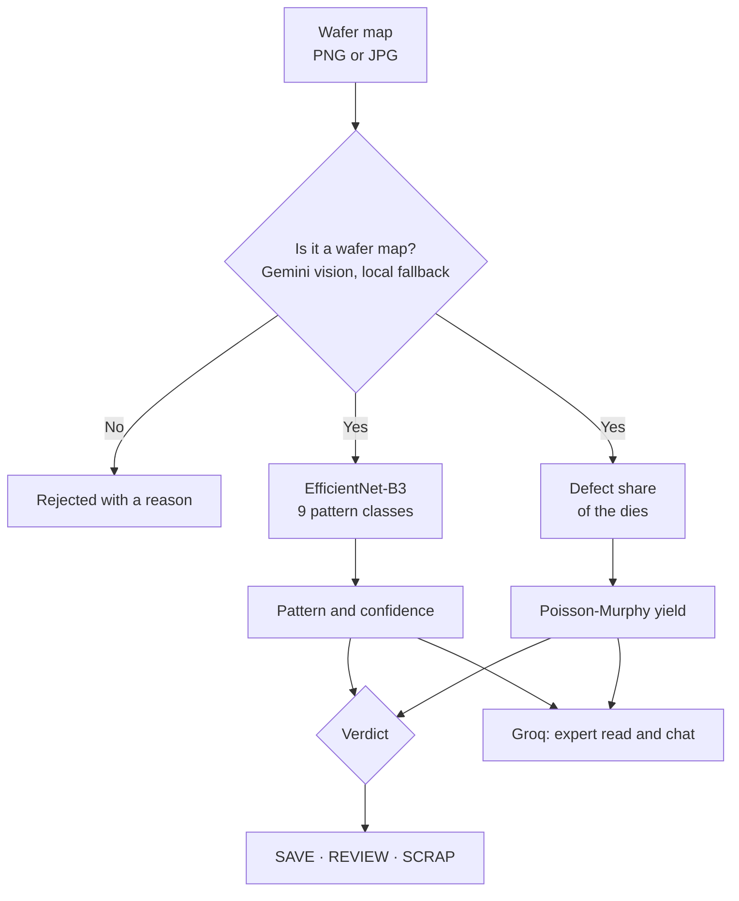
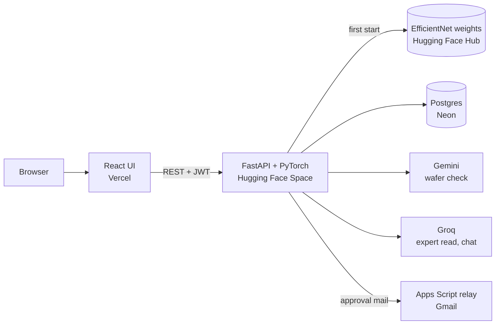
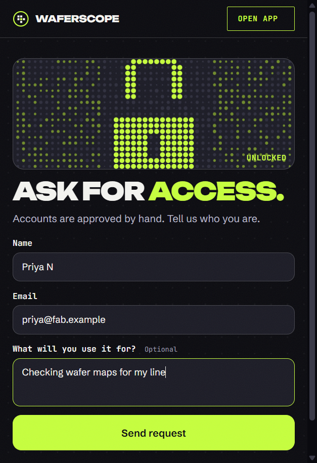

<!-- Automatically generated from README.md by .github/workflows/translate-readme.yml. Do not edit by hand. -->
<p align="center"><sub><a href="../../README.md">English</a> · <a href="README.ta.md">தமிழ்</a> · <a href="README.hi.md">हिन्दी</a> · <a href="README.te.md">తెలుగు</a> · <a href="README.ml.md">മലയാളം</a> · <a href="README.kn.md">ಕನ್ನಡ</a> · <b>বাংলা</b> · <a href="README.es.md">Español</a> · <a href="README.fr.md">Français</a> · <a href="README.de.md">Deutsch</a> · <a href="README.pt-BR.md">Português</a> · <a href="README.ja.md">日本語</a> · <a href="README.zh-CN.md">简体中文</a> · <a href="README.ar.md">العربية</a></sub></p>

<p align="center">
  <a href="https://waferscope-two.vercel.app">
    
  </a>
</p>

<p align="center">
  <a href="https://waferscope-two.vercel.app"><b>Live demo</b></a>
  &nbsp;·&nbsp;
  <a href="#how-it-works">How it works</a>
  &nbsp;·&nbsp;
  <a href="#run-it-yourself">Run it yourself</a>
</p>

<p align="center">
  
  
  
  
  
</p>


Waferscope একটি সেমিকন্ডাক্টর ওয়েফার মানচিত্র পড়ে এবং আপনাকে তিনটি বিষয় জানায়: **নয়টি ত্রুটি প্যাটার্নের মধ্যে কোনটি দেখাচ্ছে, প্রত্যাশিত ফলন কত, এবং ওয়েফারটি সংরক্ষণ, পর্যালোচনা বা বর্জন করা উচিত কিনা**। এটি ফলাফলের একটি বিশেষজ্ঞ ব্যাখ্যা সরল ভাষায় যোগ করে এবং স্ক্যানটি জানে এমন একটি চ্যাট প্রদান করে।

যেকেউ কোনো অ্যাকাউন্ট ছাড়াই এটি চেষ্টা করতে পারে: [স্ক্যান পেজে](https://waferscope-two.vercel.app/scan) একটি নমুনা ওয়েফার ট্যাপ করুন, অথবা আপনার নিজের মানচিত্র ড্রপ করুন। সম্পূর্ণ কর্মক্ষেত্র (ব্যাচ স্ক্যান, অঙ্কন, ইতিহাস, রিপোর্ট, বিশেষজ্ঞ বট) অনুমোদিত অ্যাকাউন্টের জন্য।

<p align="center">
  
</p>

## Features

* **Pattern, yield and verdict.** WM-811K-তে প্রশিক্ষিত একটি ক্লাসিফায়ার নয়টি প্যাটার্নের মধ্যে একটি (`Center`, `Donut`, `Edge-Loc`, `Edge-Ring`, `Loc`, `Near-full`, `Random`, `Scratch`, `none`) তার আত্মবিশ্বাসসহ নির্ধারণ করে। খারাপ ডাইয়ের অংশকে ফলনে রূপান্তর করা হয় এবং একটি **SAVE**, **REVIEW** অথবা **SCRAP** কল জারি করা হয়।
* **কোনো কিছু করার আগে ওয়েফার চেক।** আপলোডগুলো প্রথমে ওয়েফার মানচিত্র কিনা তা পরীক্ষা করা হয় (Gemini ভিশন, স্থানীয় রঙ‑ও‑টেক্সচার ফallback সহ), ফলে সেলফি বা এক্স‑রে প্রত্যাখ্যান করা হয় এবং ক্লাসিফাই করা হয় না।
* **বিশেষজ্ঞ ব্যাখ্যা ও চ্যাট।** একটি ল্যাঙ্গুয়েজ মডেল (Groq) সম্ভাব্য কারণ ও পরবর্তী ধাপ ব্যাখ্যা করে, এবং স্ক্যানের প্রেক্ষাপটে অনুসরণী প্রশ্নের উত্তর দেয়। এটি ওয়েফার সম্পর্কিত নয় এমন কোনো অনুরোধ প্রত্যাখ্যান করে।
* **ব্যাচ স্ক্যান।** একসাথে দশটি ওয়েফার পর্যন্ত, প্রতিটি ফাইলের জন্য একটি ফলাফল এবং একটি সারাংশ সহ।
* **ড্রয় মোড।** একটি ফাঁকা ওয়েফারে ত্রুটি আঁকুন এবং স্ক্যান করুন।
* **ফলন বিশ্লেষণ, ইতিহাস ও রিপোর্ট।** যেকোনো ডাই এলাকার জন্য একটি ফলন বক্ররেখা, প্রতিটি স্ক্যানের ফিল্টারযোগ্য ইতিহাস, এবং প্রিন্টযোগ্য রিপোর্ট।
* **অ্যাক্সেস অনুরোধ প্রবাহ।** অ্যাকাউন্টগুলো হাতে অনুমোদিত হয়। একটি অনুরোধ অ্যাডমিনকে ইমেইল করে, যিনি একক স্বাক্ষরিত লিঙ্ক দিয়ে অনুমোদন বা প্রত্যাখ্যান করেন; অনুমোদিত ব্যবহারকারী ইমেইল দ্বারা তার সাইন‑ইন বিবরণ পায়।

<p align="center">
  
</p>

## How it works

The path of a wafer map through the system:



### Yield and verdict

The share of bad dies, `s`, becomes a Poisson defect density for the reference 0.5 cm² die, `AD = -ln(1 - s) × (die area / 0.5)`, and Murphy's model turns that into a yield:

```
yield = ((1 - e^(-AD)) / AD)²
```

A larger die catches proportionally more of the damage, which is why the die-area slider moves the number. The verdict follows the yield (70 and above is **SAVE**, 40 to 70 is **REVIEW**, below 40 is **SCRAP**), with one rule on top: a *systematic* pattern (`Edge-Ring`, `Donut`, `Scratch`, `Center`) points at a process problem rather than a stray particle, so even a high yield is held for **REVIEW**.

> The sample wafers on the public pages use their drawn die map for "dies affected" and yield, so the numbers agree with what you see. For an uploaded image the backend estimates the defect share from pixels, which is an approximation.

### Architecture



The API exposes:

| Area | Endpoints |
|---|---|
| Scanning | `POST /predict-guest` (rate limited, no account), `POST /predict`, `POST /predict-draw`, `POST /yield-curve`, `GET /classes`, `GET /health` |
| Expert | `POST /explain`, `POST /chat` |
| Accounts | `POST /auth/login`, `GET /auth/me`, `POST /auth/request` |
| Admin | `GET /admin/requests`, `POST /admin/requests/{id}/{approve or reject}`, `GET`/`POST /admin/users`, `PUT`/`DELETE /admin/users/{id}` |
| History | `POST /history/save`, `GET /history/me`, `DELETE /history/{id}` |

### On a phone

The wafer on the request page becomes a dot-matrix padlock: each finished field fills it, and at 3/3 a key turns and the lock opens.

<p align="center">
  
</p>

## Tech stack

| | |
|---|---|
| **Frontend** | React 18, TypeScript, Vite, React Router, Framer Motion, Recharts, three.js, Axios. Hosted on Vercel. |
| **Backend** | FastAPI, PyTorch and torchvision (EfficientNet-B3), OpenCV, SQLAlchemy, JWT, bcrypt. Docker, hosted on a Hugging Face Space. |
| **Data** | Postgres on Neon (a local SQLite file when `DATABASE_URL` is not set). |
| **AI** | Gemini for the wafer check, Groq for the expert read and chat. Model weights: [`totz07/wafer-defect-classifier`](https://huggingface.co/totz07/wafer-defect-classifier). |
| **Mail** | A small Google Apps Script relay ([`backend/apps_script_mail_relay.gs`](../../backend/apps_script_mail_relay.gs)). |

The classifier is trained on [WM-811K](https://www.kaggle.com/datasets/qingyi/wm811k-wafer-map), a public set of 811,457 wafer maps.

<a id="run-it-yourself"></a>

## Run it yourself

```bash
git clone https://github.com/aristotile-dev/Semiconductor-Wafer-Detection-System.git
cd Semiconductor-Wafer-Detection-System
npm install
```

**Just the interface, no backend.** The mock mode answers every request in the browser:

```bash
npm run dev:mock
```

Open `http://localhost:5173` and sign in with `admin@waferscope.test` / `demo-admin` or `demo@waferscope.test` / `demo-user`. Results in this mode come from a mock, not the real model.

**The full stack.**

```bash
# backend (Python 3.11)
cd backend
pip install -r requirements.txt
cp .env.example .env        # fill in the values, see the comments inside
uvicorn main:app --reload --port 7860

# frontend, in a second terminal
echo "VITE_API_BASE_URL=http://localhost:7860" > .env
npm run dev
```

`backend/.env.example` explains every variable. Without `DATABASE_URL` the API uses a local SQLite file, and without the mail relay it simply skips the approval emails.

### Docker

```bash
cd backend
docker build -t waferscope-api .
docker run -p 7860:7860 --env-file .env waferscope-api
```

## Project layout

```
Semiconductor-Wafer-Detection-System
│
├── src/                          React + TypeScript frontend
│   ├── pages/
│   │   ├── Landing.tsx           public home: the nine patterns, one-tap sample
│   │   ├── Scan.tsx              public guest scan, no account needed
│   │   ├── Login.tsx · RequestAccess.tsx
│   │   └── Prediction · BatchPrediction · DrawMode · YieldAnalysis
│   │       History · Reports · UserManagement      signed-in workspace
│   ├── components/
│   │   ├── DieMap · DieStage     the wafer drawings (canvas)
│   │   ├── ResultPanel.tsx       verdict, odds, expert read, chat drawer
│   │   ├── LockBox · FillWafer   the request-access animations
│   │   ├── WaferScene.tsx        three.js wafer for live uploads
│   │   └── AppShell · TopNav     navigation and the bottom dock
│   ├── lib/
│   │   ├── patterns.ts           nine patterns, Poisson-Murphy yield, verdict rule
│   │   └── sampleResults.json    live-model results for the bundled samples
│   ├── api/
│   │   ├── client.ts             Axios client
│   │   └── mock.ts               in-browser mock for `npm run dev:mock`
│   └── styles/                   global, landing, public, app
│
├── public/samples/               one real WM-811K map per pattern
│
├── backend/                      FastAPI + PyTorch API
│   ├── main.py                   endpoints, auth, request and approval flow, rate limits
│   ├── model_utils.py            EfficientNet-B3, Grad-CAM, yield, verdict
│   ├── wafer_check.py            local wafer check, used when Gemini is unavailable
│   ├── nlp_utils.py              Gemini wafer check, Groq expert read and chat
│   ├── auth.py · database.py     JWT, passwords, SQLAlchemy models
│   ├── mailer.py · mail_templates.py · apps_script_mail_relay.gs
│   ├── Dockerfile                image used by the Hugging Face Space
│   └── .env.example              every setting, explained
│
├── assets/                       README screenshots
└── vercel.json                   single-page-app rewrite for Vercel
```

## License

MIT. See [LICENSE](../../LICENSE).
