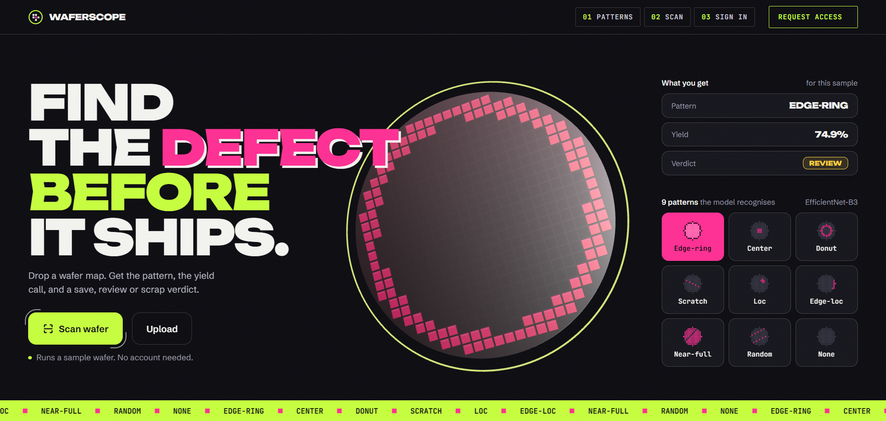
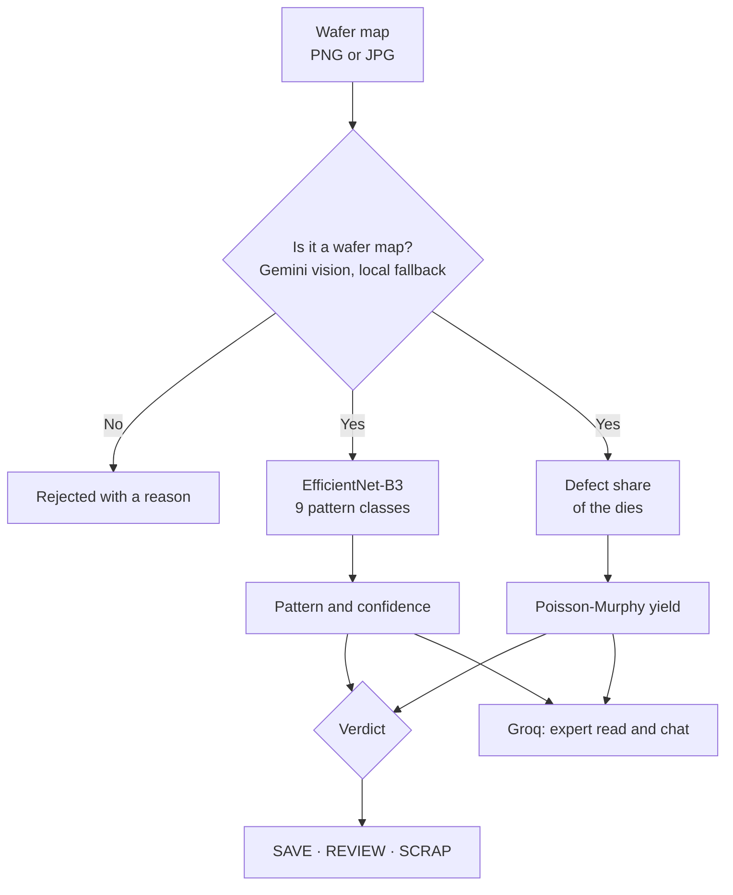
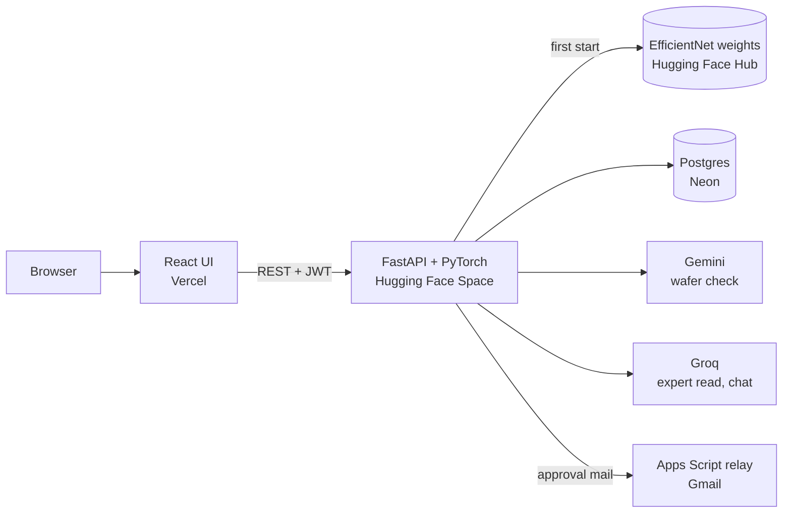

<!-- Automatically generated from README.md by .github/workflows/translate-readme.yml. Do not edit by hand. -->
<p align="center"><sub><a href="../../README.md">English</a> · <a href="README.ta.md">தமிழ்</a> · <a href="README.hi.md">हिन्दी</a> · <a href="README.te.md">తెలుగు</a> · <a href="README.ml.md">മലയാളം</a> · <a href="README.kn.md">ಕನ್ನಡ</a> · <a href="README.bn.md">বাংলা</a> · <a href="README.es.md">Español</a> · <a href="README.fr.md">Français</a> · <b>Deutsch</b> · <a href="README.pt-BR.md">Português</a> · <a href="README.ja.md">日本語</a> · <a href="README.zh-CN.md">简体中文</a> · <a href="README.ar.md">العربية</a></sub></p>

<p align="center">
  <a href="https://waferscope-two.vercel.app">
    
  </a>
</p>

<p align="center">
  <a href="https://waferscope-two.vercel.app"><b>Live‑Demo</b></a>
  &nbsp;·&nbsp;
  <a href="#how-it-works">Funktionsweise</a>
  &nbsp;·&nbsp;
  <a href="#run-it-yourself">Selbst ausführen</a>
</p>

<p align="center">
  
  
  
  
  
</p>


Waferscope liest eine Halbleiter‑Wafer‑Karte und gibt Ihnen drei Informationen: **welches der neun Defektmuster vorliegt, welchen Ertrag man erwarten kann und ob der Wafer gespeichert, geprüft oder verworfen werden soll.** Zusätzlich liefert es eine fachkundige Interpretation des Ergebnisses in Klartext und einen Chat, der den Scan kennt.

Jeder kann es ohne Konto ausprobieren: tippen Sie auf ein Beispiel‑Wafer auf der [Scan‑Seite](https://waferscope-two.vercel.app/scan) oder laden Sie Ihre eigene Karte hoch. Der komplette Arbeitsbereich (Batch‑Scans, Zeichnen, Verlauf, Berichte, der Expert‑Bot) steht nur für freigegebene Konten zur Verfügung.

<p align="center">
  
</p>

## Features

* **Muster, Ertrag und Urteil.** Ein auf WM‑811K trainierter Klassifikator benennt eines von neun Mustern (`Center`, `Donut`, `Edge-Loc`, `Edge-Ring`, `Loc`, `Near-full`, `Random`, `Scratch`, `none`) mit seiner Sicherheit. Der Anteil defekter Dies wird in einen Ertrag umgerechnet und führt zu einem **SAVE**, **REVIEW** oder **SCRAP**‑Aufruf.
* **Ein Wafer‑Check vor allem anderen.** Uploads werden zuerst darauf geprüft, dass es sich um eine Wafer‑Karte handelt (Gemini Vision, mit einem lokalen Farb‑ und Textur‑Fallback); ein Selfie oder ein Röntgenbild wird abgelehnt, anstatt klassifiziert zu werden.
* **Fachkundige Auswertung und Chat.** Ein Sprachmodell (Groq) erklärt die wahrscheinliche Ursache und den nächsten Schritt und beantwortet Anschlussfragen im Kontext dieses Scans. Es lehnt alles ab, was nicht mit Wafern zu tun hat.
* **Batch‑Scans.** Bis zu zehn Wafer gleichzeitig, mit einem Urteil pro Datei und einer Zusammenfassung.
* **Zeichnungsmodus.** Zeichnen Sie einen Defekt auf einen leeren Wafer und scannen Sie ihn.
* **Ertragsanalyse, Verlauf und Berichte.** Eine Ertragskurve für jede Die‑Fläche, ein filterbarer Verlauf aller Scans und ein druckbarer Bericht.
* **Zugriffsanfrage‑Workflow.** Konten werden manuell freigegeben. Eine Anfrage mailt den Administrator, der sie mit einem signierten Link genehmigt oder ablehnt; der freigegebene Nutzer erhält seine Anmeldedaten per E‑Mail.

<p align="center">
  
</p>

## How it works

Der Weg einer Wafer‑Karte durch das System:



### Yield and verdict

Der Anteil defekter Dies, `s`, wird zu einer Poisson‑Defektdichte für das Referenz‑0,5 cm²‑Die umgerechnet: `AD = -ln(1 - s) × (die area / 0.5)`, und Murphy’s Modell wandelt das in einen Ertrag um:

```
yield = ((1 - e^(-AD)) / AD)²
```

Ein größeres Die erfasst proportional mehr Schaden, weshalb der Die‑Flächen‑Slider die Zahl verändert. Das Urteil folgt dem Ertrag (≥ 70 % **SAVE**, 40–70 % **REVIEW**, < 40 % **SCRAP**), mit einer zusätzlichen Regel: ein *systematisches* Muster (`Edge-Ring`, `Donut`, `Scratch`, `Center`) weist auf ein Prozessproblem hin statt auf ein einzelnes Teilchen, sodass selbst bei hohem Ertrag **REVIEW** gilt.

> Die Beispiel‑Wafer auf den öffentlichen Seiten verwenden ihre gezeichnete Die‑Karte für „betroffene Dies“ und Ertrag, sodass die Zahlen mit dem Übereinstimmen, was Sie sehen. Bei einem hochgeladenen Bild schätzt das Backend den Defektanteil aus Pixeln, was eine Annäherung ist.

### Architecture



Die API stellt bereit:

| Area | Endpoints |
|---|---|
| Scanning | `POST /predict-guest` (rate limited, no account), `POST /predict`, `POST /predict-draw`, `POST /yield-curve`, `GET /classes`, `GET /health` |
| Expert | `POST /explain`, `POST /chat` |
| Accounts | `POST /auth/login`, `GET /auth/me`, `POST /auth/request` |
| Admin | `GET /admin/requests`, `POST /admin/requests/{id}/{approve or reject}`, `GET`/`POST /admin/users`, `PUT`/`DELETE /admin/users/{id}` |
| History | `POST /history/save`, `GET /history/me`, `DELETE /history/{id}` |

### On a phone

Der Wafer auf der Anfrageseite wird zu einem Punkt‑Matrix‑Vorhängeschloss: jedes ausgefüllte Feld füllt es, und bei 3/3 dreht sich ein Schlüssel und das Schloss öffnet sich.

<p align="center">
  
</p>

## Tech stack

| | |
|---|---|
| **Frontend** | React 18, TypeScript, Vite, React Router, Framer Motion, Recharts, three.js, Axios. Hosted on Vercel. |
| **Backend** | FastAPI, PyTorch and torchvision (EfficientNet-B3), OpenCV, SQLAlchemy, JWT, bcrypt. Docker, hosted on a Hugging Face Space. |
| **Data** | Postgres on Neon (a local SQLite file when `DATABASE_URL` is not set). |
| **AI** | Gemini for the wafer check, Groq for the expert read and chat. Model weights: [`totz07/wafer-defect-classifier`](https://huggingface.co/totz07/wafer-defect-classifier). |
| **Mail** | A small Google Apps Script relay ([`backend/apps_script_mail_relay.gs`](../../backend/apps_script_mail_relay.gs)). |

Der Klassifikator wurde auf [WM‑811K](https://www.kaggle.com/datasets/qingyi/wm811k-wafer-map) trainiert, einem öffentlichen Datensatz von 811 457 Wafer‑Karten.

<a id="run-it-yourself"></a>

## Run it yourself

```bash
git clone https://github.com/aristotile-dev/Semiconductor-Wafer-Detection-System.git
cd Semiconductor-Wafer-Detection-System
npm install
```

**Nur die Oberfläche, kein Backend.** Der Mock‑Modus beantwortet jede Anfrage im Browser:

```bash
npm run dev:mock
```

Öffnen Sie `http://localhost:5173` und melden Sie sich mit `admin@waferscope.test` / `demo-admin` oder `demo@waferscope.test` / `demo-user` an. Ergebnisse in diesem Modus stammen aus einem Mock, nicht aus dem echten Modell.

**Der komplette Stack.**

```bash
# backend (Python 3.11)
cd backend
pip install -r requirements.txt
cp .env.example .env        # fill in the values, see the comments inside
uvicorn main:app --reload --port 7860

# frontend, in a second terminal
echo "VITE_API_BASE_URL=http://localhost:7860" > .env
npm run dev
```

`backend/.env.example` erklärt jede Variable. Ohne `DATABASE_URL` verwendet die API eine lokale SQLite‑Datei, und ohne den Mail‑Relay wird die Versand‑E‑Mail einfach übersprungen.

### Docker

```bash
cd backend
docker build -t waferscope-api .
docker run -p 7860:7860 --env-file .env waferscope-api
```

## Project layout

```
Semiconductor-Wafer-Detection-System
│
├── src/                          React + TypeScript frontend
│   ├── pages/
│   │   ├── Landing.tsx           public home: the nine patterns, one-tap sample
│   │   ├── Scan.tsx              public guest scan, no account needed
│   │   ├── Login.tsx · RequestAccess.tsx
│   │   └── Prediction · BatchPrediction · DrawMode · YieldAnalysis
│   │       History · Reports · UserManagement      signed-in workspace
│   ├── components/
│   │   ├── DieMap · DieStage     the wafer drawings (canvas)
│   │   ├── ResultPanel.tsx       verdict, odds, expert read, chat drawer
│   │   ├── LockBox · FillWafer   the request-access animations
│   │   ├── WaferScene.tsx        three.js wafer for live uploads
│   │   └── AppShell · TopNav     navigation and the bottom dock
│   ├── lib/
│   │   ├── patterns.ts           nine patterns, Poisson-Murphy yield, verdict rule
│   │   └── sampleResults.json    live-model results for the bundled samples
│   ├── api/
│   │   ├── client.ts             Axios client
│   │   └── mock.ts               in-browser mock for `npm run dev:mock`
│   └── styles/                   global, landing, public, app
│
├── public/samples/               one real WM-811K map per pattern
│
├── backend/                      FastAPI + PyTorch API
│   ├── main.py                   endpoints, auth, request and approval flow, rate limits
│   ├── model_utils.py            EfficientNet-B3, Grad-CAM, yield, verdict
│   ├── wafer_check.py            local wafer check, used when Gemini is unavailable
│   ├── nlp_utils.py              Gemini wafer check, Groq expert read and chat
│   ├── auth.py · database.py     JWT, passwords, SQLAlchemy models
│   ├── mailer.py · mail_templates.py · apps_script_mail_relay.gs
│   ├── Dockerfile                image used by the Hugging Face Space
│   └── .env.example              every setting, explained
│
├── assets/                       README screenshots
└── vercel.json                   single-page-app rewrite for Vercel
```

## License

MIT. See [LICENSE](../../LICENSE).
