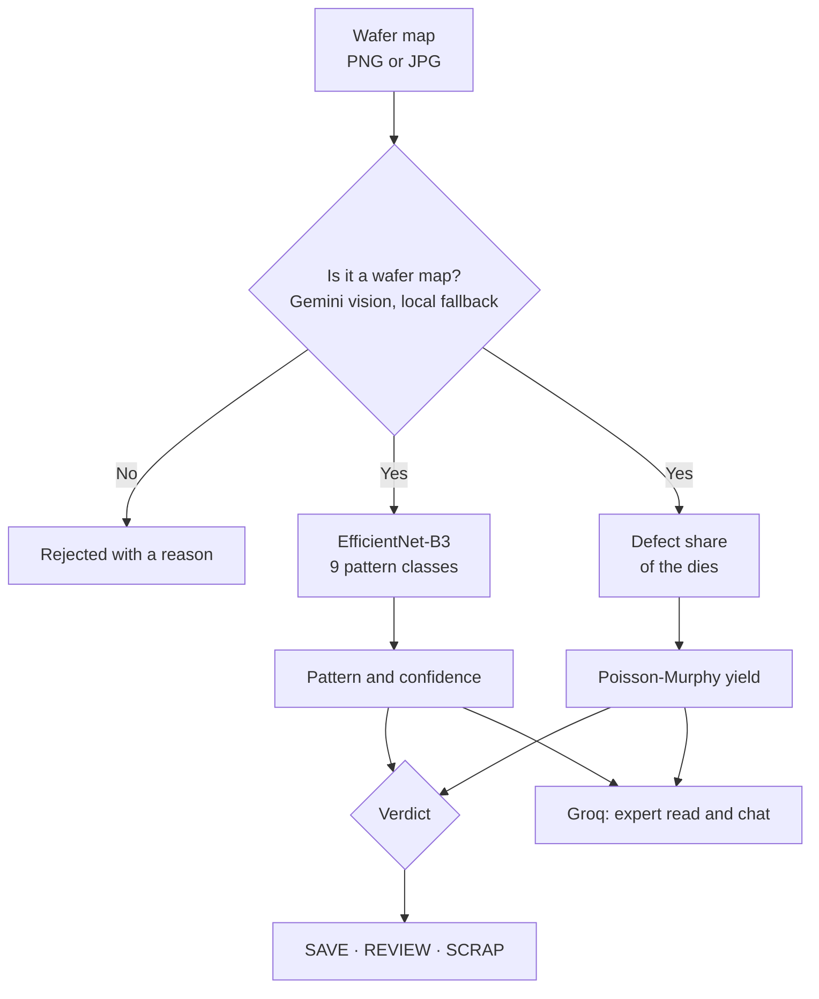
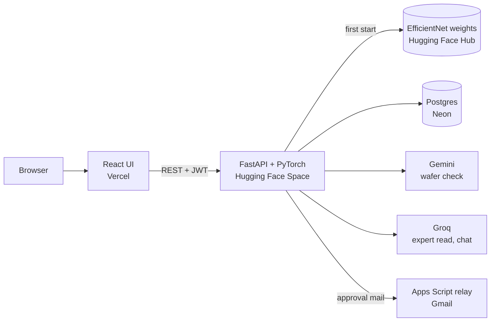

<!-- Automatically generated from README.md by .github/workflows/translate-readme.yml. Do not edit by hand. -->
<p align="center"><sub><a href="../../README.md">English</a> · <a href="README.ta.md">தமிழ்</a> · <a href="README.hi.md">हिन्दी</a> · <a href="README.te.md">తెలుగు</a> · <a href="README.ml.md">മലയാളം</a> · <a href="README.kn.md">ಕನ್ನಡ</a> · <a href="README.bn.md">বাংলা</a> · <a href="README.es.md">Español</a> · <b>Français</b> · <a href="README.de.md">Deutsch</a> · <a href="README.pt-BR.md">Português</a> · <a href="README.ja.md">日本語</a> · <a href="README.zh-CN.md">简体中文</a> · <a href="README.ar.md">العربية</a></sub></p>

<p align="center">
  <a href="https://waferscope-two.vercel.app">
    
  </a>
</p>

<p align="center">
  <a href="https://waferscope-two.vercel.app"><b>Démo en ligne</b></a>
  &nbsp;·&nbsp;
  <a href="#how-it-works">Fonctionnement</a>
  &nbsp;·&nbsp;
  <a href="#run-it-yourself">Lancer vous‑même</a>
</p>

<p align="center">
  
  
  
  
  
</p>


Waferscope lit une carte de wafer semi‑conducteur et vous indique trois choses : **lequel des neuf motifs de défaut il présente, le rendement attendu, et s’il faut conserver, examiner ou mettre au rebut le wafer**. Il ajoute une lecture experte du résultat en langage clair ainsi qu’un chat qui connaît le scan.

Tout le monde peut l’essayer sans compte : touchez un wafer d’exemple sur la [page de scan](https://waferscope-two.vercel.app/scan), ou déposez votre propre carte. L’espace complet (scans par lots, dessin, historique, rapports, le bot expert) est réservé aux comptes approuvés.

<p align="center">
  
</p>

## Features

* **Motif, rendement et verdict.** Un classificateur entraîné sur WM-811K nomme l’un des neuf motifs (`Center`, `Donut`, `Edge-Loc`, `Edge-Ring`, `Loc`, `Near-full`, `Random`, `Scratch`, `none`) avec sa confiance. La part de dies défectueux est convertie en rendement et en appel **SAVE**, **REVIEW** ou **SCRAP**.
* **Un contrôle du wafer avant toute autre chose.** Les téléchargements sont d’abord vérifiés comme étant une carte de wafer (vision Gemini, avec une solution de secours locale couleur‑et‑texture), de sorte qu’un selfie ou une radiographie soit rejeté plutôt que classifié.
* **Lecture experte et chat.** Un modèle de langage (Groq) explique la cause probable et l’étape suivante, et répond aux questions de suivi dans le contexte de ce scan. Il refuse tout ce qui ne concerne pas les wafers.
* **Scans par lots.** Jusqu’à dix wafers simultanément, avec un verdict par fichier et un résumé.
* **Mode dessin.** Peignez un défaut sur un wafer vierge et scannez‑le.
* **Analyse de rendement, historique et rapports.** Une courbe de rendement pour toute zone de die, un historique filtrable de chaque scan, et un rapport imprimable.
* **Flux de demande d’accès.** Les comptes sont approuvés manuellement. Une demande envoie un courriel à l’administrateur, qui l’approuve ou la rejette via un lien signé ; l’utilisateur approuvé reçoit ses informations de connexion par courriel.

<p align="center">
  
</p>

## How it works

Le parcours d’une carte de wafer à travers le système :



### Yield and verdict

La part de dies défectueux, `s`, devient une densité de défauts de Poisson pour le die de référence de 0,5 cm², `AD = -ln(1 - s) × (die area / 0.5)`, et le modèle de Murphy la transforme en rendement :

```
yield = ((1 - e^(-AD)) / AD)²
```

Un die plus grand capte proportionnellement davantage de dommages, d’où le curseur de surface du die qui fait varier le nombre. Le verdict suit le rendement (70 et plus → **SAVE**, 40 à 70 → **REVIEW**, moins de 40 → **SCRAP**), avec une règle supplémentaire : un motif *systématique* (`Edge-Ring`, `Donut`, `Scratch`, `Center`) indique un problème de procédé plutôt qu’une particule errante, ainsi même un rendement élevé conduit à **REVIEW**.

> Les wafers d’exemple sur les pages publiques utilisent leur carte de die dessinée pour « dies affected » et le rendement, de sorte que les chiffres correspondent à ce que vous voyez. Pour une image téléchargée, le backend estime la part de défauts à partir des pixels, ce qui reste une approximation.

### Architecture



L’API expose :

| Area | Endpoints |
|---|---|
| Scanning | `POST /predict-guest` (limité, pas de compte), `POST /predict`, `POST /predict-draw`, `POST /yield-curve`, `GET /classes`, `GET /health` |
| Expert | `POST /explain`, `POST /chat` |
| Accounts | `POST /auth/login`, `GET /auth/me`, `POST /auth/request` |
| Admin | `GET /admin/requests`, `POST /admin/requests/{id}/{approve or reject}`, `GET`/`POST /admin/users`, `PUT`/`DELETE /admin/users/{id}` |
| History | `POST /history/save`, `GET /history/me`, `DELETE /history/{id}` |

### On a phone

Le wafer sur la page de demande devient un cadenas à points : chaque champ rempli le colore, et à 3/3 une clé tourne et le verrou s’ouvre.

<p align="center">
  
</p>

## Tech stack

| | |
|---|---|
| **Frontend** | React 18, TypeScript, Vite, React Router, Framer Motion, Recharts, three.js, Axios. Hébergé sur Vercel. |
| **Backend** | FastAPI, PyTorch et torchvision (EfficientNet-B3), OpenCV, SQLAlchemy, JWT, bcrypt. Docker, hébergé sur un Hugging Face Space. |
| **Data** | Postgres sur Neon (un fichier SQLite local lorsque `DATABASE_URL` n’est pas défini). |
| **AI** | Gemini pour la vérification du wafer, Groq pour la lecture experte et le chat. Poids du modèle : [`totz07/wafer-defect-classifier`](https://huggingface.co/totz07/wafer-defect-classifier). |
| **Mail** | Un petit relais Google Apps Script ([`backend/apps_script_mail_relay.gs`](../../backend/apps_script_mail_relay.gs)). |

Le classificateur est entraîné sur [WM-811K](https://www.kaggle.com/datasets/qingyi/wm811k-wafer-map), un ensemble public de 811 457 cartes de wafer.

<a id="run-it-yourself"></a>

## Run it yourself

```bash
git clone https://github.com/aristotile-dev/Semiconductor-Wafer-Detection-System.git
cd Semiconductor-Wafer-Detection-System
npm install
```

**Just the interface, no backend.** Le mode mock répond à chaque requête dans le navigateur :

```bash
npm run dev:mock
```

Ouvrez `http://localhost:5173` et connectez‑vous avec `admin@waferscope.test` / `demo-admin` ou `demo@waferscope.test` / `demo-user`. Les résultats dans ce mode proviennent d’un mock, pas du vrai modèle.

**The full stack.**

```bash
# backend (Python 3.11)
cd backend
pip install -r requirements.txt
cp .env.example .env        # fill in the values, see the comments inside
uvicorn main:app --reload --port 7860

# frontend, in a second terminal
echo "VITE_API_BASE_URL=http://localhost:7860" > .env
npm run dev
```

`backend/.env.example` explique chaque variable. Sans `DATABASE_URL` l’API utilise un fichier SQLite local, et sans le relais de courriel il ignore simplement les courriels d’approbation.

### Docker

```bash
cd backend
docker build -t waferscope-api .
docker run -p 7860:7860 --env-file .env waferscope-api
```

## Project layout

```
Semiconductor-Wafer-Detection-System
│
├── src/                          React + TypeScript frontend
│   ├── pages/
│   │   ├── Landing.tsx           public home: the nine patterns, one-tap sample
│   │   ├── Scan.tsx              public guest scan, no account needed
│   │   ├── Login.tsx · RequestAccess.tsx
│   │   └── Prediction · BatchPrediction · DrawMode · YieldAnalysis
│   │       History · Reports · UserManagement      signed-in workspace
│   ├── components/
│   │   ├── DieMap · DieStage     the wafer drawings (canvas)
│   │   ├── ResultPanel.tsx       verdict, odds, expert read, chat drawer
│   │   ├── LockBox · FillWafer   the request-access animations
│   │   ├── WaferScene.tsx        three.js wafer for live uploads
│   │   └── AppShell · TopNav     navigation and the bottom dock
│   ├── lib/
│   │   ├── patterns.ts           nine patterns, Poisson-Murphy yield, verdict rule
│   │   └── sampleResults.json    live-model results for the bundled samples
│   ├── api/
│   │   ├── client.ts             Axios client
│   │   └── mock.ts               in-browser mock for `npm run dev:mock`
│   └── styles/                   global, landing, public, app
│
├── public/samples/               one real WM-811K map per pattern
│
├── backend/                      FastAPI + PyTorch API
│   ├── main.py                   endpoints, auth, request and approval flow, rate limits
│   ├── model_utils.py            EfficientNet-B3, Grad-CAM, yield, verdict
│   ├── wafer_check.py            local wafer check, used when Gemini is unavailable
│   ├── nlp_utils.py              Gemini wafer check, Groq expert read and chat
│   ├── auth.py · database.py     JWT, passwords, SQLAlchemy models
│   ├── mailer.py · mail_templates.py · apps_script_mail_relay.gs
│   ├── Dockerfile                image used by the Hugging Face Space
│   └── .env.example              every setting, explained
│
├── assets/                       README screenshots
└── vercel.json                   single-page-app rewrite for Vercel
```

## License

MIT. Voir [LICENSE](../../LICENSE).
