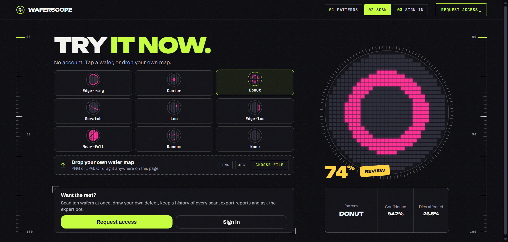
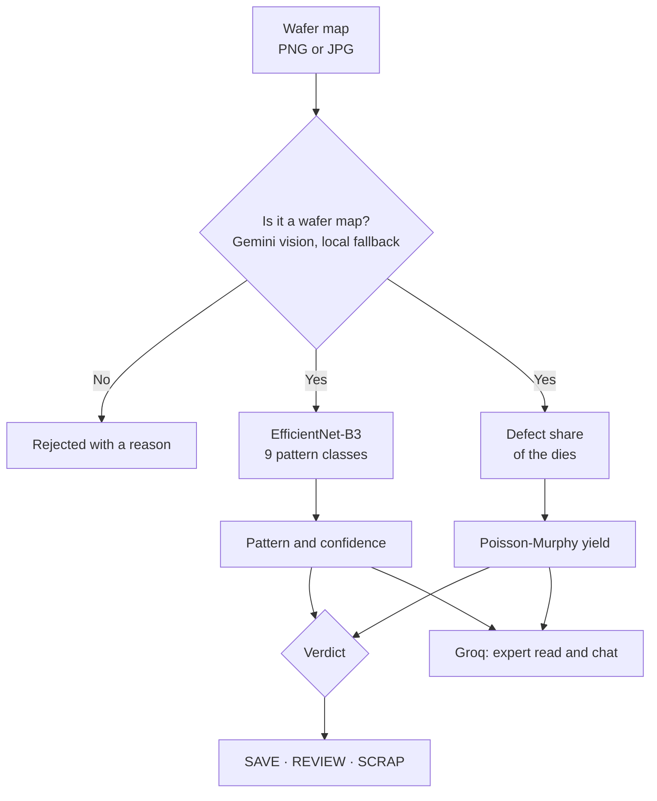
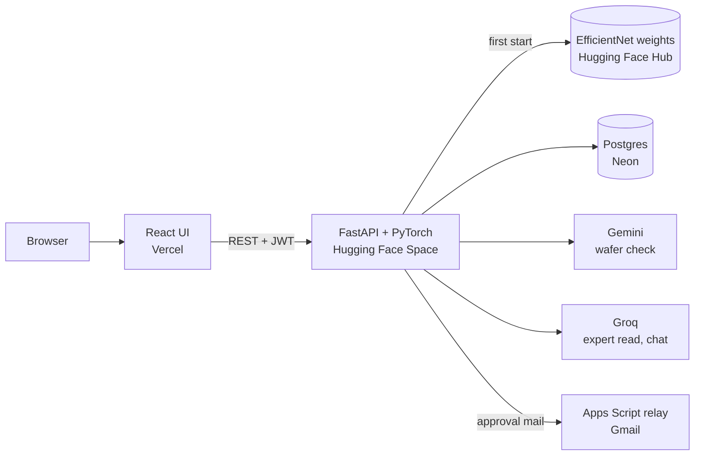

<!-- Automatically generated from README.md by .github/workflows/translate-readme.yml. Do not edit by hand. -->
<p align="center"><sub><a href="../../README.md">English</a> · <a href="README.ta.md">தமிழ்</a> · <a href="README.hi.md">हिन्दी</a> · <a href="README.te.md">తెలుగు</a> · <a href="README.ml.md">മലയാളം</a> · <a href="README.kn.md">ಕನ್ನಡ</a> · <a href="README.bn.md">বাংলা</a> · <a href="README.es.md">Español</a> · <a href="README.fr.md">Français</a> · <a href="README.de.md">Deutsch</a> · <b>Português</b> · <a href="README.ja.md">日本語</a> · <a href="README.zh-CN.md">简体中文</a> · <a href="README.ar.md">العربية</a></sub></p>

<p align="center">
  <a href="https://waferscope-two.vercel.app">
    
  </a>
</p>

<p align="center">
  <a href="https://waferscope-two.vercel.app"><b>Demo ao vivo</b></a>
  &nbsp;·&nbsp;
  <a href="#how-it-works">Como funciona</a>
  &nbsp;·&nbsp;
  <a href="#run-it-yourself">Execute você mesmo</a>
</p>

<p align="center">
  
  
  
  
  
</p>


Waferscope lê um mapa de wafer semicondutor e informa três coisas: **qual dos nove padrões de defeito ele apresenta, qual rendimento esperar e se deve salvar, revisar ou descartar o wafer.** Ele adiciona uma leitura especializada do resultado em linguagem simples e um chat que conhece a varredura.

Qualquer pessoa pode experimentar sem conta: toque em um wafer de exemplo na [página de varredura](https://waferscope-two.vercel.app/scan) ou carregue seu próprio mapa. O espaço de trabalho completo (varreduras em lote, desenho, histórico, relatórios, o bot especialista) está disponível apenas para contas aprovadas.

<p align="center">
  
</p>

## Features

* **Padrão, rendimento e veredicto.** Um classificador treinado no WM-811K nomeia um dos nove padrões (`Center`, `Donut`, `Edge-Loc`, `Edge-Ring`, `Loc`, `Near-full`, `Random`, `Scratch`, `none`) com sua confiança. A proporção de dies defeituosos é convertida em rendimento e em uma chamada **SAVE**, **REVIEW** ou **SCRAP**.
* **Uma verificação de wafer antes de qualquer outra coisa.** Os uploads são verificados primeiro para serem um mapa de wafer (visão Gemini, com fallback local de cor e textura), de modo que uma selfie ou um raio‑X seja rejeitado ao invés de classificado.
* **Leitura especializada e chat.** Um modelo de linguagem (Groq) explica a causa provável e o próximo passo, e responde a perguntas de acompanhamento no contexto daquela varredura. Ele recusa qualquer coisa que não seja sobre wafers.
* **Varreduras em lote.** Até dez wafers de uma vez, com veredicto por arquivo e um resumo.
* **Modo de desenho.** Pinte um defeito em um wafer em branco e varra-o.
* **Análise de rendimento, histórico e relatórios.** Uma curva de rendimento para qualquer área de die, um histórico filtrável de cada varredura e um relatório imprimível.
* **Fluxo de solicitação de acesso.** Contas são aprovadas manualmente. Uma solicitação envia e‑mail ao administrador, que aprova ou rejeita com um link assinado; o usuário aprovado recebe seus dados de login por e‑mail.

<p align="center">
  
</p>

## How it works

O caminho de um mapa de wafer através do sistema:



### Yield and verdict

A proporção de dies defeituosos, `s`, torna‑se uma densidade de defeitos de Poisson para o die de referência de 0,5 cm², `AD = -ln(1 - s) × (die area / 0.5)`, e o modelo de Murphy converte isso em rendimento:

```
yield = ((1 - e^(-AD)) / AD)²
```

Um die maior captura proporcionalmente mais dano, por isso o controle deslizante de área do die altera o número. O veredicto segue o rendimento (70 ou mais é **SAVE**, de 40 a 70 é **REVIEW**, abaixo de 40 é **SCRAP**), com uma regra adicional: um padrão *sistemático* (`Edge-Ring`, `Donut`, `Scratch`, `Center`) indica um problema de processo em vez de uma partícula isolada, portanto mesmo um rendimento alto é mantido como **REVIEW**.

> Os wafers de exemplo nas páginas públicas usam seu mapa de dies desenhado para “dies afetados” e rendimento, de modo que os números coincidem com o que você vê. Para uma imagem enviada, o backend estima a proporção de defeitos a partir dos pixels, o que é uma aproximação.

### Architecture



A API expõe:

| Area | Endpoints |
|---|---|
| Scanning | `POST /predict-guest` (rate limited, no account), `POST /predict`, `POST /predict-draw`, `POST /yield-curve`, `GET /classes`, `GET /health` |
| Expert | `POST /explain`, `POST /chat` |
| Accounts | `POST /auth/login`, `GET /auth/me`, `POST /auth/request` |
| Admin | `GET /admin/requests`, `POST /admin/requests/{id}/{approve or reject}`, `GET`/`POST /admin/users`, `PUT`/`DELETE /admin/users/{id}` |
| History | `POST /history/save`, `GET /history/me`, `DELETE /history/{id}` |

### On a phone

O wafer na página de solicitação torna‑se um cadeado de matriz de pontos: cada campo concluído o preenche, e em 3/3 uma chave gira e o cadeado abre.

<p align="center">
  
</p>

## Tech stack

| | |
|---|---|
| **Frontend** | React 18, TypeScript, Vite, React Router, Framer Motion, Recharts, three.js, Axios. Hospedado no Vercel. |
| **Backend** | FastAPI, PyTorch e torchvision (EfficientNet-B3), OpenCV, SQLAlchemy, JWT, bcrypt. Docker, hospedado em um Hugging Face Space. |
| **Data** | Postgres no Neon (um arquivo SQLite local quando `DATABASE_URL` não está definido). |
| **AI** | Gemini para a verificação de wafer, Groq para a leitura especializada e chat. Pesos do modelo: [`totz07/wafer-defect-classifier`](https://huggingface.co/totz07/wafer-defect-classifier). |
| **Mail** | Um pequeno relé de Google Apps Script ([`backend/apps_script_mail_relay.gs`](../../backend/apps_script_mail_relay.gs)). |

O classificador foi treinado no [WM-811K](https://www.kaggle.com/datasets/qingyi/wm811k-wafer-map), um conjunto público de 811 457 mapas de wafer.

<a id="run-it-yourself"></a>

## Run it yourself

```bash
git clone https://github.com/aristotile-dev/Semiconductor-Wafer-Detection-System.git
cd Semiconductor-Wafer-Detection-System
npm install
```

**Apenas a interface, sem backend.** O modo mock responde a todas as requisições no navegador:

```bash
npm run dev:mock
```

Abra `http://localhost:5173` e faça login com `admin@waferscope.test` / `demo-admin` ou `demo@waferscope.test` / `demo-user`. Resultados neste modo vêm de um mock, não do modelo real.

**A pilha completa.**

```bash
# backend (Python 3.11)
cd backend
pip install -r requirements.txt
cp .env.example .env        # fill in the values, see the comments inside
uvicorn main:app --reload --port 7860

# frontend, in a second terminal
echo "VITE_API_BASE_URL=http://localhost:7860" > .env
npm run dev
```

`backend/.env.example` explica cada variável. Sem `DATABASE_URL` a API usa um arquivo SQLite local, e sem o relé de e‑mail simplesmente ignora os e‑mails de aprovação.

### Docker

```bash
cd backend
docker build -t waferscope-api .
docker run -p 7860:7860 --env-file .env waferscope-api
```

## Project layout

```
Semiconductor-Wafer-Detection-System
│
├── src/                          React + TypeScript frontend
│   ├── pages/
│   │   ├── Landing.tsx           public home: the nine patterns, one-tap sample
│   │   ├── Scan.tsx              public guest scan, no account needed
│   │   ├── Login.tsx · RequestAccess.tsx
│   │   └── Prediction · BatchPrediction · DrawMode · YieldAnalysis
│   │       History · Reports · UserManagement      signed-in workspace
│   ├── components/
│   │   ├── DieMap · DieStage     the wafer drawings (canvas)
│   │   ├── ResultPanel.tsx       verdict, odds, expert read, chat drawer
│   │   ├── LockBox · FillWafer   the request-access animations
│   │   ├── WaferScene.tsx        three.js wafer for live uploads
│   │   └── AppShell · TopNav     navigation and the bottom dock
│   ├── lib/
│   │   ├── patterns.ts           nine patterns, Poisson-Murphy yield, verdict rule
│   │   └── sampleResults.json    live-model results for the bundled samples
│   ├── api/
│   │   ├── client.ts             Axios client
│   │   └── mock.ts               in-browser mock for `npm run dev:mock`
│   └── styles/                   global, landing, public, app
│
├── public/samples/               one real WM-811K map per pattern
│
├── backend/                      FastAPI + PyTorch API
│   ├── main.py                   endpoints, auth, request and approval flow, rate limits
│   ├── model_utils.py            EfficientNet-B3, Grad-CAM, yield, verdict
│   ├── wafer_check.py            local wafer check, used when Gemini is unavailable
│   ├── nlp_utils.py              Gemini wafer check, Groq expert read and chat
│   ├── auth.py · database.py     JWT, passwords, SQLAlchemy models
│   ├── mailer.py · mail_templates.py · apps_script_mail_relay.gs
│   ├── Dockerfile                image used by the Hugging Face Space
│   └── .env.example              every setting, explained
│
├── assets/                       README screenshots
└── vercel.json                   single-page-app rewrite for Vercel
```

## License

MIT. See [LICENSE](../../LICENSE).
