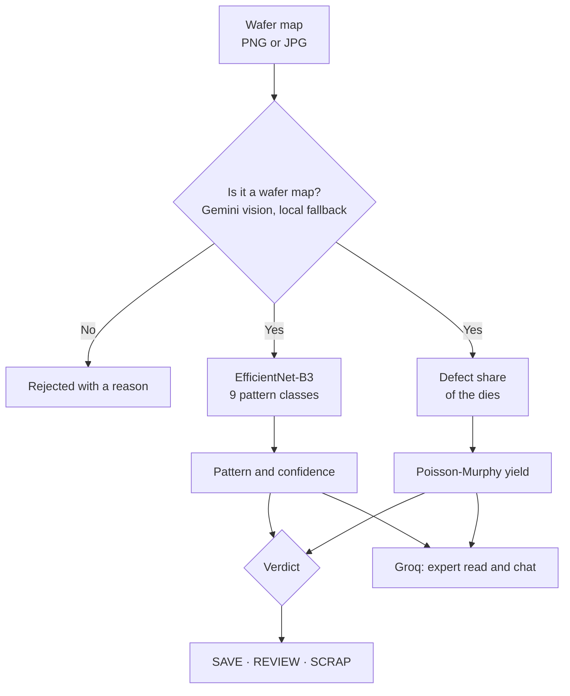
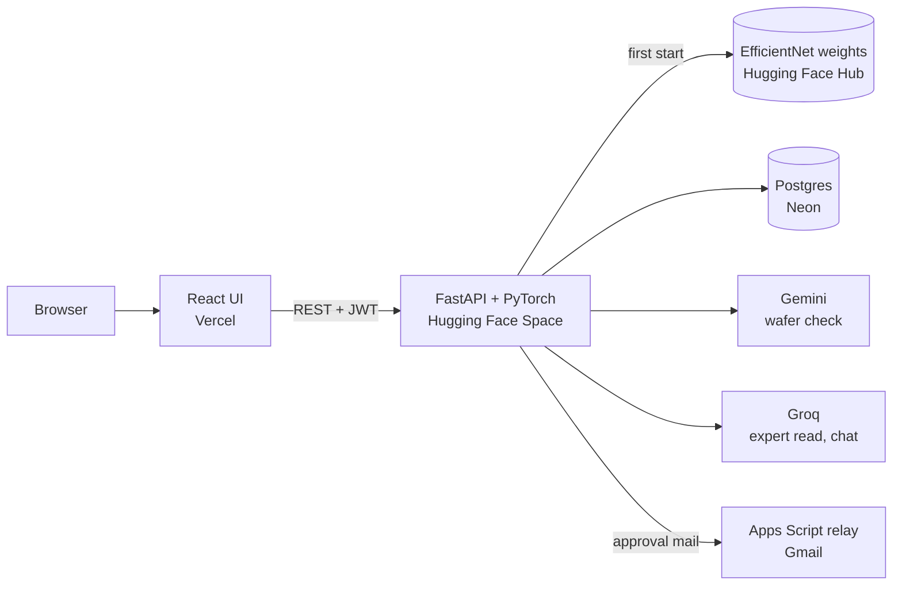

<!-- Automatically generated from README.md by .github/workflows/translate-readme.yml. Do not edit by hand. -->
<p align="center"><sub><a href="../../README.md">English</a> · <b>தமிழ்</b> · <a href="README.hi.md">हिन्दी</a> · <a href="README.te.md">తెలుగు</a> · <a href="README.ml.md">മലയാളം</a> · <a href="README.kn.md">ಕನ್ನಡ</a> · <a href="README.bn.md">বাংলা</a> · <a href="README.es.md">Español</a> · <a href="README.fr.md">Français</a> · <a href="README.de.md">Deutsch</a> · <a href="README.pt-BR.md">Português</a> · <a href="README.ja.md">日本語</a> · <a href="README.zh-CN.md">简体中文</a> · <a href="README.ar.md">العربية</a></sub></p>

<p align="center">
  <a href="https://waferscope-two.vercel.app">
    
  </a>
</p>

<p align="center">
  <a href="https://waferscope-two.vercel.app"><b>Live demo</b></a>
  &nbsp;·&nbsp;
  <a href="#how-it-works">How it works</a>
  &nbsp;·&nbsp;
  <a href="#run-it-yourself">Run it yourself</a>
</p>

<p align="center">
  
  
  
  
  
</p>


Waferscope ஒரு அரைமின்கட்டின் வெஃப் வரைபடத்தைப் படித்து, மூன்று விஷயங்களைச் சொல்கிறது: **ஒன்பது குறைபாடு மாதிரிகளில் எது, எதிர்பார்க்கப்படும் விளைவு, மற்றும் வெஃப்பை சேமிக்க, மதிப்பாய்வு செய்ய அல்லது குப்பை செய்ய வேண்டுமா** என்பதை. இது முடிவை எளிய மொழியில் நிபுணர் விளக்கமாகவும், ஸ்கேனை அறிந்த ஒரு உரையாடலாகவும் வழங்குகிறது.

எந்த கணக்கும் இல்லாமல் யாரும் முயற்சிக்கலாம்: [ஸ்கேன் பக்கம்](https://waferscope-two.vercel.app/scan) இல் ஒரு மாதிரி வெஃப்பைத் தேர்ந்தெடுக்கவும், அல்லது உங்கள் சொந்த வரைபடத்தை இழுக்கவும். முழு பணியிடம் (பேட்ச் ஸ்கேன்கள், வரைதல், வரலாறு, அறிக்கைகள், நிபுணர் பாட்ட்) அங்கீகரிக்கப்பட்ட கணக்குகளுக்காக மட்டுமே.

<p align="center">
  
</p>

## Features

* **Pattern, yield and verdict.** WM-811K இல் பயிற்சி பெற்ற ஒரு வகைப்பாட்டி ஒன்பது மாதிரிகளில் ஒன்றை (`Center`, `Donut`, `Edge-Loc`, `Edge-Ring`, `Loc`, `Near-full`, `Random`, `Scratch`, `none`) அதன் நம்பிக்கையுடன் குறிப்பிடுகிறது. மோசமான டைஸ்களின் பகுதி ஒரு விளைவு (yield) ஆக மாற்றப்பட்டு **SAVE**, **REVIEW** அல்லது **SCRAP** அழைப்பு வழங்கப்படுகிறது.
* **மற்ற அனைத்திற்கும் முன் ஒரு வெஃப் சரிபார்ப்பு.** பதிவேற்றங்கள் முதலில் வெஃப் வரைபடம் என்பதை (Gemini vision, உள்ளூர் நிறம்‑மற்றும்‑தெக்ஸ்சர் பின்னடைவு) சரிபார்க்கிறது, ஆகவே ஒரு செல்ஃபி அல்லது எக்ஸ்‑ரே வகைப்படுத்தப்படுவதற்கு பதிலாக நிராகரிக்கப்படும்.
* **நிபுணர் விளக்கம் மற்றும் உரையாடல்.** ஒரு மொழி மாதிரி (Groq) சாத்தியமான காரணம் மற்றும் அடுத்த படியை விளக்குகிறது, மேலும் அந்த ஸ்கேனின் சூழலில் பின்வரும் கேள்விகளுக்கு பதிலளிக்கிறது. இது வெஃப்புகள் தொடர்பில்லாத எந்தக் கேள்வியையும் நிராகரிக்கும்.
* **Batch scans.** ஒரே நேரத்தில் பத்து வரைபடங்கள் வரை, ஒவ்வொரு கோப்புக்கும் முடிவு மற்றும் சுருக்கம் வழங்கப்படும்.
* **Draw mode.** வெற்று வெஃப்பில் ஒரு குறைபாட்டை வரையவும், பின்னர் அதை ஸ்கேன் செய்யவும்.
* **Yield analysis, history and reports.** எந்த டை எரியாவிற்கும் ஒரு விளைவு வளைவு, ஒவ்வொரு ஸ்கேனின் வடிகட்டக்கூடிய வரலாறு, மற்றும் அச்சிடக்கூடிய அறிக்கை.
* **Request access flow.** கணக்குகள் கைமுறையாக அங்கீகரிக்கப்படும். ஒரு கோரிக்கை நிர்வாகிக்கு மின்னஞ்சல் அனுப்பப்படும்; அவர் ஒரு கையொப்பமிட்ட இணைப்புடன் அதை அங்கீகரிக்க அல்லது நிராகரிக்க முடியும்; அங்கீகரிக்கப்பட்ட பயனர் தனது உள்நுழைவு விவரங்களை மின்னஞ்சலில் பெறுவார்.

<p align="center">
  
</p>

## How it works

The path of a wafer map through the system:



### Yield and verdict

The share of bad dies, `s`, becomes a Poisson defect density for the reference 0.5 cm² die, `AD = -ln(1 - s) × (die area / 0.5)`, and Murphy's model turns that into a yield:

```
yield = ((1 - e^(-AD)) / AD)²
```

A larger die catches proportionally more of the damage, which is why the die-area slider moves the number. The verdict follows the yield (70 and above is **SAVE**, 40 to 70 is **REVIEW**, below 40 is **SCRAP**), with one rule on top: a *systematic* pattern (`Edge-Ring`, `Donut`, `Scratch`, `Center`) points at a process problem rather than a stray particle, so even a high yield is held for **REVIEW**.

> The sample wafers on the public pages use their drawn die map for "dies affected" and yield, so the numbers agree with what you see. For an uploaded image the backend estimates the defect share from pixels, which is an approximation.

### Architecture



The API exposes:

| Area | Endpoints |
|---|---|
| Scanning | `POST /predict-guest` (rate limited, no account), `POST /predict`, `POST /predict-draw`, `POST /yield-curve`, `GET /classes`, `GET /health` |
| Expert | `POST /explain`, `POST /chat` |
| Accounts | `POST /auth/login`, `GET /auth/me`, `POST /auth/request` |
| Admin | `GET /admin/requests`, `POST /admin/requests/{id}/{approve or reject}`, `GET`/`POST /admin/users`, `PUT`/`DELETE /admin/users/{id}` |
| History | `POST /history/save`, `GET /history/me`, `DELETE /history/{id}` |

### On a phone

The wafer on the request page becomes a dot-matrix padlock: each finished field fills it, and at 3/3 a key turns and the lock opens.

<p align="center">
  
</p>

## Tech stack

| | |
|---|---|
| **Frontend** | React 18, TypeScript, Vite, React Router, Framer Motion, Recharts, three.js, Axios. Hosted on Vercel. |
| **Backend** | FastAPI, PyTorch and torchvision (EfficientNet-B3), OpenCV, SQLAlchemy, JWT, bcrypt. Docker, hosted on a Hugging Face Space. |
| **Data** | Postgres on Neon (a local SQLite file when `DATABASE_URL` is not set). |
| **AI** | Gemini for the wafer check, Groq for the expert read and chat. Model weights: [`totz07/wafer-defect-classifier`](https://huggingface.co/totz07/wafer-defect-classifier). |
| **Mail** | A small Google Apps Script relay ([`backend/apps_script_mail_relay.gs`](../../backend/apps_script_mail_relay.gs)). |

The classifier is trained on [WM-811K](https://www.kaggle.com/datasets/qingyi/wm811k-wafer-map), a public set of 811,457 wafer maps.

<a id="run-it-yourself"></a>

## Run it yourself

```bash
git clone https://github.com/aristotile-dev/Semiconductor-Wafer-Detection-System.git
cd Semiconductor-Wafer-Detection-System
npm install
```

**Just the interface, no backend.** The mock mode answers every request in the browser:

```bash
npm run dev:mock
```

Open `http://localhost:5173` and sign in with `admin@waferscope.test` / `demo-admin` or `demo@waferscope.test` / `demo-user`. Results in this mode come from a mock, not the real model.

**The full stack.**

```bash
# backend (Python 3.11)
cd backend
pip install -r requirements.txt
cp .env.example .env        # fill in the values, see the comments inside
uvicorn main:app --reload --port 7860

# frontend, in a second terminal
echo "VITE_API_BASE_URL=http://localhost:7860" > .env
npm run dev
```

`backend/.env.example` explains every variable. Without `DATABASE_URL` the API uses a local SQLite file, and without the mail relay it simply skips the approval emails.

### Docker

```bash
cd backend
docker build -t waferscope-api .
docker run -p 7860:7860 --env-file .env waferscope-api
```

## Project layout

```
Semiconductor-Wafer-Detection-System
│
├── src/                          React + TypeScript frontend
│   ├── pages/
│   │   ├── Landing.tsx           public home: the nine patterns, one-tap sample
│   │   ├── Scan.tsx              public guest scan, no account needed
│   │   ├── Login.tsx · RequestAccess.tsx
│   │   └── Prediction · BatchPrediction · DrawMode · YieldAnalysis
│   │       History · Reports · UserManagement      signed-in workspace
│   ├── components/
│   │   ├── DieMap · DieStage     the wafer drawings (canvas)
│   │   ├── ResultPanel.tsx       verdict, odds, expert read, chat drawer
│   │   ├── LockBox · FillWafer   the request-access animations
│   │   ├── WaferScene.tsx        three.js wafer for live uploads
│   │   └── AppShell · TopNav     navigation and the bottom dock
│   ├── lib/
│   │   ├── patterns.ts           nine patterns, Poisson-Murphy yield, verdict rule
│   │   └── sampleResults.json    live-model results for the bundled samples
│   ├── api/
│   │   ├── client.ts             Axios client
│   │   └── mock.ts               in-browser mock for `npm run dev:mock`
│   └── styles/                   global, landing, public, app
│
├── public/samples/               one real WM-811K map per pattern
│
├── backend/                      FastAPI + PyTorch API
│   ├── main.py                   endpoints, auth, request and approval flow, rate limits
│   ├── model_utils.py            EfficientNet-B3, Grad-CAM, yield, verdict
│   ├── wafer_check.py            local wafer check, used when Gemini is unavailable
│   ├── nlp_utils.py              Gemini wafer check, Groq expert read and chat
│   ├── auth.py · database.py     JWT, passwords, SQLAlchemy models
│   ├── mailer.py · mail_templates.py · apps_script_mail_relay.gs
│   ├── Dockerfile                image used by the Hugging Face Space
│   └── .env.example              every setting, explained
│
├── assets/                       README screenshots
└── vercel.json                   single-page-app rewrite for Vercel
```

## License

MIT. See [LICENSE](../../LICENSE).
